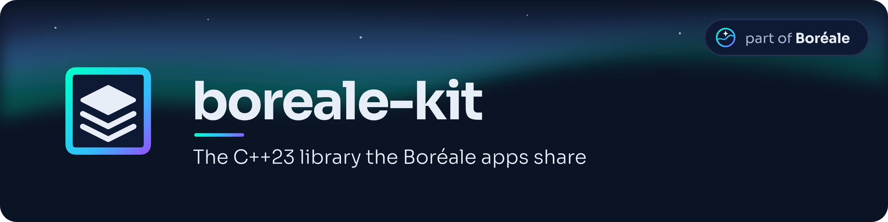

The C++23 library the Boréale apps share: network, updates, development
builds, logs, GitHub, diagnostics, and the screens and flows they have in
common.

## Using it

The kit is a submodule of each app, `library/boreale-kit`, pinned on a
release tag (`vX.Y.Z`), never on a commit of `main`. Its `source/` is added
to the app's include path and its files to the app's build, with the app's
own toolchain and flags (the Switch's, the desktop's). The kit asks the app
for its identity and settings through `kit_app.hpp` and `kit_settings.hpp`
(which the app implements), for its names through the app's `app_id.h`, and
for its screens through `ui/app_hooks.hpp`.

The kit's own texts are in `resources/i18n/<lang>/kit.json` (15 languages),
which the app copies into its resources before its own; the code reads them
with `kit_text::str("section/key", args…)`, where `{0}` is the app's name,
`{1}` its id and the arguments start at `{2}`. An app that must word one
differently gives the key `<app id>/kit/<section>/<key>` in its own catalog.
`tools/check_resources.py` checks the keys, the languages and the arguments.

`make test` runs the host tests (gcc or clang, with the sanitizers);
`make check` adds the layer rules (`tools/check_sources.py`) and the string
catalogs (`tools/check_resources.py`).
